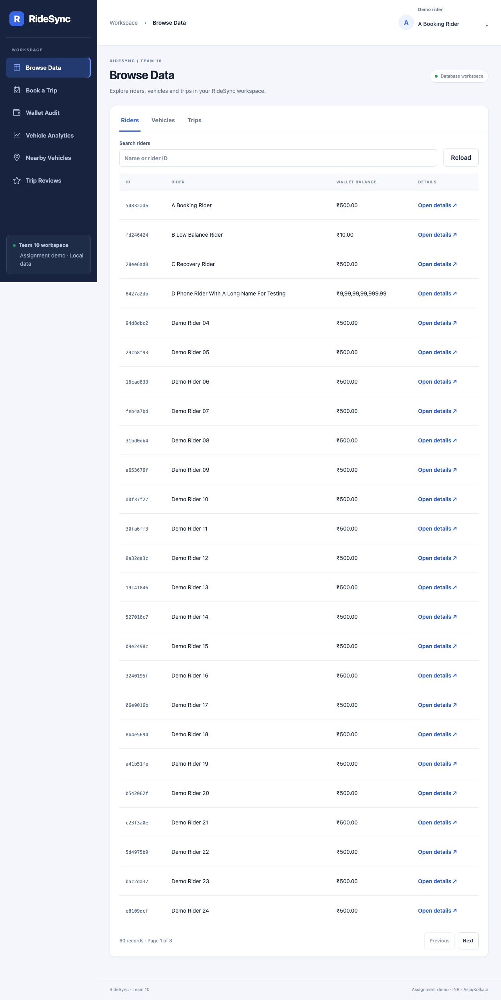
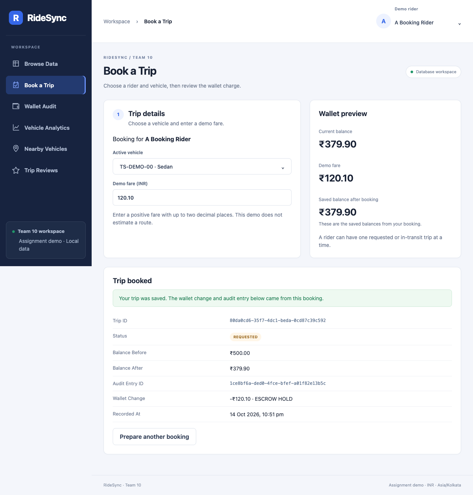
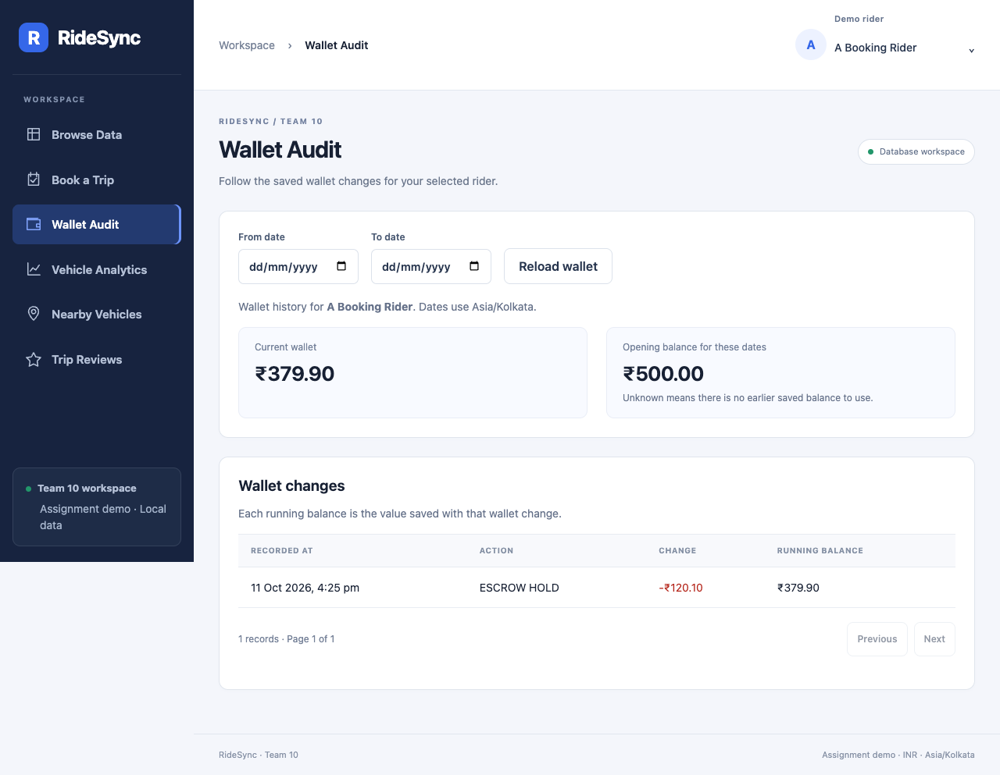
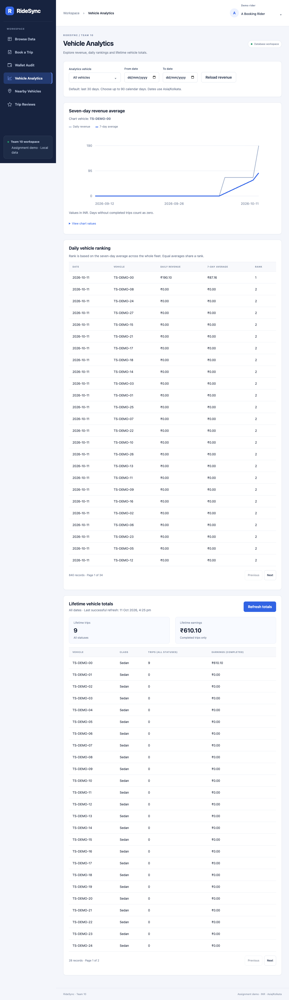
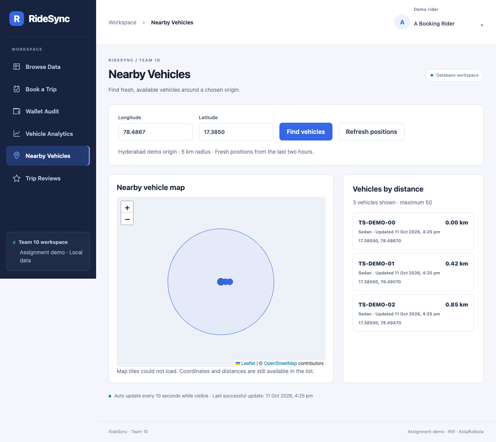
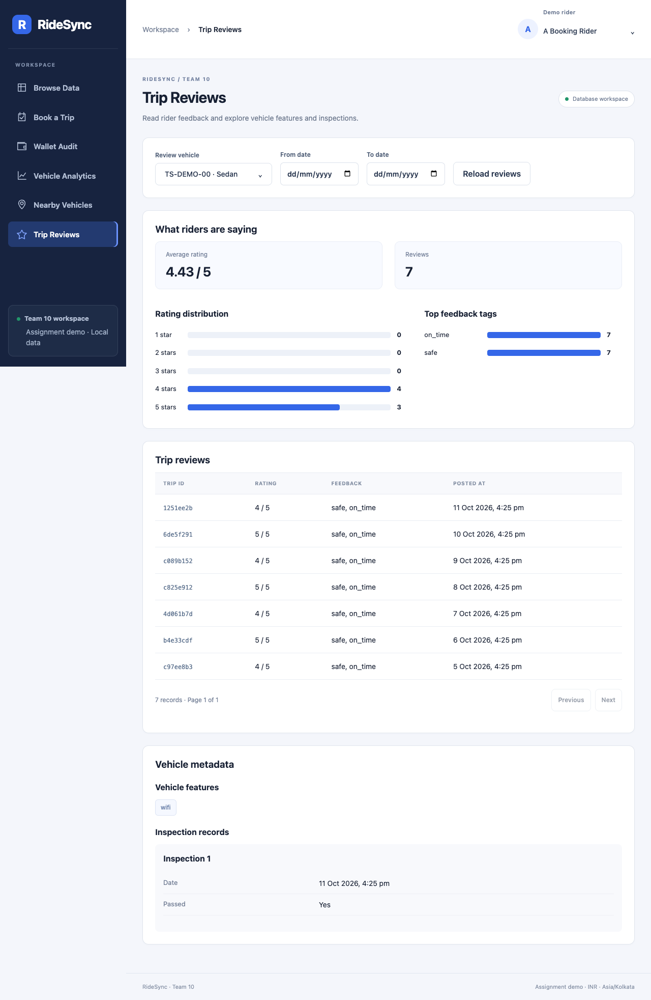
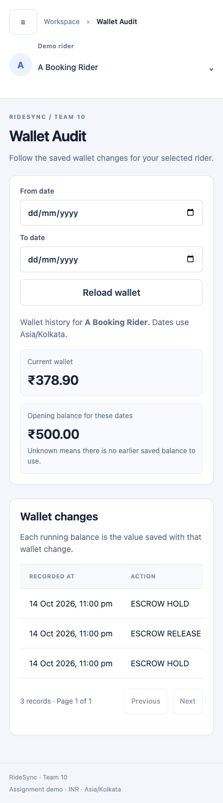

# RideSync — Team 10, Assignment 2 (Front End Design)

RideSync is a ride-booking application. This is **Project P2**. It puts a web front end and a small API on top of a PostgreSQL + MongoDB backend that another team built in Assignment 1.

| | |
|---|---|
| Team | 10 |
| Team repository | https://github.com/Atharvojha/Ride_Booking_21 |
| Inherited repository | https://github.com/amaan070/Ride_Booking_21 (starting commit `d0d5ad44ba4ab2f566cd965e055870ddd7e95697`, all 23 original commits kept) |
| Final commit hash | `865a7ffb937a051353c30a65131dbfbf3543adcc` (the last commit before this line was added; a file cannot contain the hash of its own commit) |
| Demo video (5 minutes at most) | [docs/demo/demo.mp4](docs/demo/demo.mp4) (1 minute, 12 MB; GitHub plays it in the browser) |

## Contents

1. [What the application does](#what-the-application-does)
2. [Screenshots](#screenshots)
3. [Setup](#setup)
4. [Tests](#tests)
5. [Technology choices](#technology-choices)
6. [Assumptions](#assumptions)
7. [Changes to the inherited database scripts](#changes-to-the-inherited-database-scripts)
8. [Repository structure and documents](#repository-structure-and-documents)
9. [Contribution table](#contribution-table)
10. [Inherited Assignment 1 documentation](#inherited-assignment-1-documentation) (kept below for attribution)

## What the application does

Two kinds of users: a **rider** (books trips, checks their wallet) and a **fleet operator** (browses data, moves trips through their statuses, checks revenue, nearby vehicles and reviews). The header has a searchable demo-rider selector. There is no real login. Users and wireframes are in [docs/design](docs/design/README.md).

| Screen | What you can do | Database work |
|---|---|---|
| Browse Data | Search, filter, page through riders, vehicles and trips; open a record; start and complete a trip | SQL tables, paged in the database (at most 100 rows per page) |
| Book a Trip | Pick a rider and an active vehicle, enter a fare, see the balance before and after and the new wallet audit entry; friendly messages for low balance and for a second active trip | `sp_book_trip`, the wallet audit trigger and the partial unique index |
| Wallet Audit | See a rider's wallet history with a date filter and the saved running balance | `wallet_audit_logs` |
| Vehicle Analytics | Seven-day moving-average chart, daily `DENSE_RANK` table, lifetime totals with a "last refreshed" time and a refresh button | window-function query, materialized view |
| Nearby Vehicles | Type an origin (longitude and latitude); see vehicles within 5 km on a map and in a list sorted by distance; new positions appear without reloading (polling) | MongoDB `$geoNear` |
| Trip Reviews | Rating distribution, average, top tags, review list and a vehicle's flexible metadata (features, inspections) | MongoDB `$facet`, `VehicleMetadata` |

Every screen shows loading, empty and error messages, and works on a laptop and on a phone. Endpoint inputs and outputs are in [docs/api_endpoints.md](docs/api_endpoints.md).

## Screenshots

These were taken by the browser tests, using small temporary test records (not real accounts). The map capture has map tiles blocked, so the markers and distance list are shown without the background map.

| | |
|---|---|
|  Browse |  Booking with audit entry |
|  Wallet audit |  Analytics |
|  Nearby vehicles |  Reviews and metadata |
| <br>Phone layout (wallet audit) | |

## Setup

**You need:** PostgreSQL, MongoDB, `mongosh`, Python 3.11 or newer (we used 3.13; the API tests also pass on 3.11.3), Node.js 22.22.2, 24.15 or newer (we used 26.8; the web test tools do not support Node 20) and Git. Both databases must be running. Your PostgreSQL role must be allowed to create databases. We did not provide a `docker-compose.yml`.

### 1. Create and fill the databases

Run these from the repository root. Use a **new** database: the schema scripts are not reset scripts.

```sh
python3 -m venv .venv
source .venv/bin/activate
pip install -r api/requirements.txt -r data_generation/requirements.txt
cp .env.example .env          # then edit .env: your PostgreSQL role and password
set -a; source .env; set +a   # load the settings into this terminal
createdb "$PGDATABASE"
for script in sql/*.sql; do psql -v ON_ERROR_STOP=1 -f "$script" || break; done
mongosh "$MONGO_URI" --quiet --file mongo/01_collections_and_indexes.js
mongosh "$MONGO_URI" --quiet --file mongo/04_api_indexes.js
python data_generation/postgres_seeder.py
python data_generation/mongo_seeder.py
psql -v ON_ERROR_STOP=1 -c 'SELECT refresh_mv_vehicle_lifetime_stats();'
```

Stop if any step shows an error. Lines such as `NOTICE: ... does not exist, skipping` are normal. Notes:

- `.env` holds your passwords and is not committed. `.env.example` makes a small dataset (100 riders, 40 vehicles, 100 trips, 1,000 pings). The inherited full size is `NUM_RIDERS=100000 NUM_VEHICLES=40000 NUM_TRIPS=50000 NUM_PINGS=520000`; see [the full-size report](docs/scale_verification.md).
- `TTL_WINDOW_SECONDS` (1800 in `.env.example`) only controls how far back in time the seeder spreads the first 1,000 pings. The database deletes pings after 7,200 seconds (two hours) whatever this value is.
- The PostgreSQL seeder also writes vehicle metadata to MongoDB, so start both databases first.
- The seeders only add data. Running them again does not reset anything. Use a new database to start over.
- **Nearby Vehicles shows few or no vehicles right after the small seed.** Vehicle positions (pings) are also deleted after two hours. To add fresh ones run `python data_generation/refresh_demo_pings.py` (add `--dry-run` to see the plan first). It adds 25 pings for 25 active vehicles, of which about 19 should appear on the map. Do not run `mongo_seeder.py` again for this, because it adds the reviews a second time. A vehicle's newest ping is the one that counts, so a few helper pings can be hidden if you run it within minutes of seeding.

### 2. Start the API

```sh
python -m uvicorn api.main:app --host 127.0.0.1 --port 8000 --reload
```

Check http://127.0.0.1:8000/api/health (both databases should say `ok`). Request forms are at http://127.0.0.1:8000/docs. More in [api/README.md](api/README.md).

### 3. Start the web app

In a second terminal:

```sh
cd web
npm ci
npm run dev
```

Open http://127.0.0.1:5173. The web server passes `/api` requests to the API on port 8000. More in [web/README.md](web/README.md).

### Updating a database you already created

If your database was made from the original Assignment 1 scripts, apply the changed ones. They can be run again safely. Do not rerun `sql/01_schema_ddl.sql` or `sql/05_materialized_views.sql` on an existing database.

```sh
for script in sql/03_triggers_and_audit.sql sql/04_stored_procedures.sql sql/07_api_refresh_state.sql sql/08_api_revenue.sql; do
  psql -v ON_ERROR_STOP=1 -f "$script" || break
done
mongosh "$MONGO_URI" --quiet --file mongo/01_collections_and_indexes.js
mongosh "$MONGO_URI" --quiet --file mongo/04_api_indexes.js
```

## Tests

| Command | What it checks |
|---|---|
| `python -m pytest tests/test_api.py -q` | The API against temporary databases (63 tests): booking, low balance, second active trip, concurrent bookings, status changes, wallet history, revenue, refresh, nearby, reviews, bad input and database outages |
| `python tests/backend_smoke.py` | The inherited database scripts on a small dataset (29 checks) |
| `python -m pytest tests/test_demo_pings.py -q` | The fresh-ping helper (9 tests) |
| `cd web && npm test` | Front-end unit tests (24 tests) |
| `cd web && npm run test:browser` | Nine browser tests with the real API and temporary databases. Needs Chrome and free ports 8001 and 5174. Set `RIDESYNC_TEST_PYTHON` to your Python path. |
| `tests/scale_check.py` | Full-size checks (75 checks). It needs seeded full-size databases, so it is explained, with its command, in [docs/scale_verification.md](docs/scale_verification.md) |

The API and browser tests create their own databases and remove them. `backend_smoke.py` keeps its `ridesync_verify_*` databases so you can inspect them. Some browser failures (a lost reply, a service outage) are simulated on purpose. The browser tests also rewrite the PNG files in `docs/design/screenshots/`; run `git checkout -- docs/design/screenshots` afterwards if you do not want to keep the new captures.

## Technology choices

- **PostgreSQL and MongoDB** are inherited. PostgreSQL keeps money and trips safe with transactions, constraints and triggers. MongoDB holds flexible vehicle metadata, expiring GPS pings and map queries.
- **FastAPI** (with psycopg2 and PyMongo) is a small server that checks its inputs and describes itself at `/docs`. It calls the inherited stored procedures and pipelines instead of repeating their logic.
- **React with Vite and plain CSS** lets the six screens share forms, tables and dialogs without a heavy toolkit.
- **Leaflet with OpenStreetMap** draws the map (the attribution stays visible). **Small SVG charts** show the numbers without another chart package.
- **pytest, Vitest and Playwright** test the API, the screen logic and the real browser flows.

## Assumptions

- Money is in **INR** (the schema has no currency). The user types the fare.
- Date filters and the daily revenue use **Asia/Kolkata** days. The API sends times in UTC.
- Demo rider switching replaces login.
- The only trip statuses are `REQUESTED`, `IN TRANSIT` and `COMPLETED`. There is no cancellation or refund. Completing a trip releases the held money; it does not return the fare.
- A rider can have one `REQUESTED` or `IN TRANSIT` trip at a time. The partial unique index enforces it.
- There is no driver table, rider contact, route or pickup place in the database, so we did not add them.
- A seven-day average means seven calendar days, with zero for days without trips. Ranks compare the whole fleet on each day, and equal averages share a rank.
- A vehicle ping is current for 7,200 seconds, the same as the MongoDB expiry. Only a vehicle's newest ping counts. The demo origin is Hyderabad (longitude 78.4867, latitude 17.3850), with a 5 km radius.
- Lists show 25 rows by default and at most 100. The map refreshes every 10 seconds, only while the page is visible.
- The Figma prototype is only a design reference. We left out its features that have no data behind them.

## Changes to the inherited database scripts

| File | Change | Why |
|---|---|---|
| `mongo/02_workflow_geonear.js` | Made it a runnable `mongosh` function with a Hyderabad demo call | The original failed under `mongosh` |
| `mongo/01_collections_and_indexes.js` | Fixed the `VehicleMetadata` index name; collection setup can be repeated | The index used the wrong capital letter, so it indexed nothing |
| `mongo/03_workflow4_facet.js` | The database name comes from `MONGO_DB` | Matches the other scripts |
| `mongo/04_api_indexes.js` (new) | Indexes for each vehicle's newest ping and for review filters | Fast latest-ping and review lookups |
| `data_generation/*_seeder.py` | Connection settings come from `.env`; dataset sizes are settings | One seeder had a password in the code, the other asked for it |
| `data_generation/postgres_seeder.py` | Wallet top-ups update the real wallet; trips use active vehicles; it reads the new third value (audit ID) from `sp_book_trip` | Top-ups only changed a number in memory, so the audit trigger never ran |
| `data_generation/refresh_demo_pings.py` (new) | Adds fresh vehicle pings and nothing else | Pings expire after two hours; rerunning `mongo_seeder.py` would add the reviews again |
| `sql/03_triggers_and_audit.sql` | The trigger records the real write time and gives the new audit ID to the procedure | The API must show the exact audit row |
| `sql/04_stored_procedures.sql` | Booking checks the fare and the vehicle and returns the audit ID; completion locks the wallet before the trip | Safer input, exact audit entry, same lock order in both procedures |
| `sql/07_api_refresh_state.sql` (new) | The refresh saves its time and allows one refresh at a time | The "last refreshed" time and no overlapping refreshes |
| `sql/08_api_revenue.sql` (new) | Seven-calendar-day average with zero days and whole-fleet ranks; the inherited view is kept | The inherited view averaged seven rows, which can be weeks |
| `.env.example`, `.gitignore` | Added | Keep passwords and dependencies out of Git |
| `docs/relational_erd.jpeg` | Corrected the file name used in the README | The ERD is a JPEG |

The booking procedures end their own transactions, so the API calls them directly, never inside another transaction. We kept every original file and all original commits.

## Repository structure and documents

```text
README.md                 this file
docs/
  handover_note.md        what worked, what did not, what we changed (about one page)
  api_endpoints.md        every endpoint with inputs and outputs
  design/                 users, wireframes, screenshots
  demo/demo.mp4           the demo video (1 minute)
  scale_verification.md   full-size results, timings and query plans
  (other files)           test reports (*.json), query plans, a detailed history, the original ERD and schema map
sql/  mongo/  data_generation/   the Assignment 1 scripts plus our fixes
api/                      FastAPI server
web/                      React application
tests/                    API, helper and full-size tests
performance/              original Assignment 1 performance output
```

## Contribution table

The course expects every member to contribute to both design and code. Each member confirmed their own row.

All commits and pull requests were made from Atharv's laptop while the team worked together, so GitHub shows one committer. The table records who did what, not who typed the commits.

| Member | GitHub | Design work | Code work |
|---|---|---|---|
| Atharv Ojha | Atharvojha | Users and wireframes in `docs/design/`, the screen layouts, colours and shared components | Fixes to the inherited SQL, MongoDB and seeder scripts; the FastAPI server; the six React screens; the API, unit and browser tests; the full-size verification; the handover note and this README |
| Disha Sharma | dishasharma2003 | The Figma prototype that the six screens follow | Tested the six screens in the browser on seeded data and reported differences from the Figma |
| Vignesh | Vigneshxo9 | Checked the Vehicle Analytics screen against the Figma design and the window-function results | The PostgreSQL window-function analytics: the seven-day moving average and `DENSE_RANK` ranking (`sql/06_window_analytics.sql`, `sql/08_api_revenue.sql`) behind the Vehicle Analytics screen |
| Kyatheshwar | kyatheshwar | Checked the Nearby Vehicles and Trip Reviews screens against the Figma design and the MongoDB results | The MongoDB workflows: nearby vehicles with `$geoNear` and the `$facet` review summary with vehicle metadata (`mongo/`), behind the Nearby Vehicles and Trip Reviews screens |

---

# Inherited Assignment 1 documentation

The following original documentation is retained for attribution and background. Use the Team 10 setup steps above when running the project.

# RideSync – Ride Booking Database System

## Project Overview

RideSync is a database system designed for a ride-booking platform. The project demonstrates the use of both a relational database and a NoSQL database to manage different types of application data.

The system uses:

- **PostgreSQL** for structured, transactional, and relational data.
- **MongoDB** for flexible document data, GPS telemetry, geospatial queries, and review analytics.

The two databases are logically connected using shared UUID references.

This project demonstrates relational schema design, constraints, indexes, triggers, stored procedures, materialized views, window analytics, MongoDB geospatial queries, aggregation pipelines, TTL indexes, data generation, and performance analysis.

---

# Original Assignment 1 Team Members

| Team Member | Responsibility |
|---|---|
|**Amaan Ahmad**| MongoDB Collections, Indexes and Geospatial Queries |
|**Tarishi Hemani**|  PostgreSQL Schema Design |
|**Pal Shah**| Advanced PostgreSQL Features |
|**Sanjana Venkatesan** | Data Generation, Analytics and Performance Testing |

---

# Repository

GitHub Repository: https://github.com/amaan070/Ride_Booking_21

---

# Technologies Used

- PostgreSQL
- MongoDB Community Server
- MongoDB Shell (`mongosh`)
- Python 3

---

# Project Structure

```text
Ride_Booking_21/
│
├── README.md
│
├── sql/
│   ├── 01_schema_ddl.sql
│   ├── 02_indexes.sql
│   ├── 03_triggers_and_audit.sql
│   ├── 04_stored_procedures.sql
│   ├── 05_materialized_views.sql
│   └── 06_window_analytics.sql
│
├── mongo/
│   ├── 01_collections_and_indexes.js
│   ├── 02_workflow_geonear.js
│   └── 03_workflow4_facet.js
│
├── data_generation/
│   ├── postgres_seeder.py
│   ├── mongo_seeder.py
│   └── requirements.txt
│
├── performance/
│   ├── pg_explain_queries.sql
│   ├── mongo_execution_stats.js
│   └── mongo_output.txt
│
└── docs/
    ├── relational_erd.jpeg
    └── mongo_schema_map.json
```

---

# 1. ERDs and Schema Maps

## PostgreSQL Relational Schema

The PostgreSQL database manages the structured transactional data of the system.

The main tables are:

- `riders`
- `vehicles`
- `trips`
- `wallet_audit_logs`

The relational Entity Relationship Diagram is available at:

```text
docs/relational_erd.jpeg
```

### Main Relationships

```text
riders
   │
   │ rider_id
   ▼
trips
   ▲
   │ vehicle_id
   │
vehicles


riders
   │
   │ rider_id
   ▼
wallet_audit_logs
```

The relational schema uses:

- UUID primary keys
- Foreign key relationships
- Check constraints
- Unique constraints
- Transactional integrity

---

## MongoDB Schema Map

The MongoDB schema map is available at:

```text
docs/mongo_schema_map.json
```

The MongoDB database contains the following collections:

### VehicleMetadata

Stores flexible and optional vehicle-related information.

### TelemetryPings

Stores high-frequency GPS and vehicle availability information.

Typical fields include:

- `vehicle_id`
- `is_available`
- `location`
- `created_at`

### TripReviews

Stores trip ratings and feedback.

Typical fields include:

- `trip_id`
- `vehicle_id`
- `rating`
- `feedback_tags`
- `created_at`

---

# PostgreSQL and MongoDB Integration

PostgreSQL and MongoDB are logically connected using UUID references.

```text
PostgreSQL                         MongoDB

vehicles.id
    │
    ├────────────────────► VehicleMetadata.vehicle_id
    │
    └────────────────────► TelemetryPings.vehicle_id


trips.id
    │
    └────────────────────► TripReviews.trip_id
```

PostgreSQL is responsible for core transactional operations, while MongoDB manages flexible and high-frequency operational data.

---

# 2. Setup Scripts

## PostgreSQL Setup

The PostgreSQL database setup scripts are located in the `sql/` directory.

They should be executed in the following order:

1. `01_schema_ddl.sql`
2. `02_indexes.sql`
3. `03_triggers_and_audit.sql`
4. `04_stored_procedures.sql`
5. `05_materialized_views.sql`
6. `06_window_analytics.sql`

### PostgreSQL Schema

The main relational schema is created using:

```text
sql/01_schema_ddl.sql
```

This script creates tables, primary keys, foreign keys, constraints, and default values.

### PostgreSQL Indexes

Indexes are created using:

```text
sql/02_indexes.sql
```

These indexes improve the performance of frequently executed queries.

---

## MongoDB Setup

MongoDB collections and indexes are created using:

```text
mongo/01_collections_and_indexes.js
```

This script creates:

- `VehicleMetadata`
- `TelemetryPings`
- `TripReviews`

It also creates the required MongoDB indexes.

### MongoDB Geospatial Index

A `2dsphere` index is created on the location field of telemetry documents. This supports:

- Finding nearby vehicles
- Distance-based vehicle searches
- Finding the nearest available vehicle

### MongoDB TTL Index

A TTL index is created on:

```text
TelemetryPings.created_at
```

Old GPS telemetry data is automatically removed after the configured expiration period.

---

# Installation Requirements

Install:

- PostgreSQL
- MongoDB Community Server
- MongoDB Shell (`mongosh`)
- Python 3

Install the required Python dependencies:

```bash
pip install -r data_generation/requirements.txt
```

---

# Running the PostgreSQL Setup

Create the PostgreSQL database using the database name configured for the project.

Run the SQL scripts in the required order, for example:

```bash
psql -U postgres -d <database_name> -f sql/01_schema_ddl.sql
psql -U postgres -d <database_name> -f sql/02_indexes.sql
psql -U postgres -d <database_name> -f sql/03_triggers_and_audit.sql
psql -U postgres -d <database_name> -f sql/04_stored_procedures.sql
psql -U postgres -d <database_name> -f sql/05_materialized_views.sql
psql -U postgres -d <database_name> -f sql/06_window_analytics.sql
```

Replace `<database_name>` with the PostgreSQL database name configured in the project.

---

# Running the MongoDB Setup

Ensure that MongoDB is running.

Verify the MongoDB connection:

```bash
mongosh
```

Then run:

```javascript
db.runCommand({ ping: 1 })
```

Create the MongoDB collections and indexes.

### Windows PowerShell

```powershell
Get-Content mongo/01_collections_and_indexes.js | mongosh
```

---

# 3. Workflow Scripts

The workflow scripts demonstrate advanced PostgreSQL and MongoDB functionality.

## PostgreSQL Workflow – Triggers and Audit Logging

Located at:

```text
sql/03_triggers_and_audit.sql
```

The wallet audit trigger automatically records wallet balance changes.

```text
Wallet Balance Changes
        │
        ▼
Database Trigger
        │
        ▼
wallet_audit_logs
```

Each audit record stores:

- Rider ID
- Amount changed
- Action type
- Balance after the transaction
- Timestamp

---

## PostgreSQL Workflow – Stored Procedures

Located at:

```text
sql/04_stored_procedures.sql
```

Stored procedures handle transactional operations related to the ride-booking workflow.

```text
Rider Books a Trip
        │
        ▼
Stored Procedure Starts Transaction
        │
        ▼
Wallet Balance Checked
        │
        ▼
Fare Deducted
        │
        ▼
Wallet Audit Trigger Executes
        │
        ▼
Trip Created
        │
        ▼
Transaction Committed
```

---

## PostgreSQL Workflow – Materialized Views

Located at:

```text
sql/05_materialized_views.sql
```

Materialized views store precomputed results to support analytical queries and reduce repeated computation.

---

## PostgreSQL Workflow – Window Analytics

Located at:

```text
sql/06_window_analytics.sql
```

This script demonstrates SQL window functions, including a 7-day moving average.

```text
Daily Revenue
      │
      ▼
Window Function
      │
      ▼
7-Day Moving Average
```

---

## MongoDB Workflow – Geospatial Search

Located at:

```text
mongo/02_workflow_geonear.js
```

This workflow uses MongoDB's `$geoNear` aggregation stage.

```text
Rider Location
      │
      ▼
$geoNear
      │
      ├── Geospatial Search
      ├── Availability Filter
      └── Maximum Distance Filter
      │
      ▼
Nearest Available Vehicle
```

The workflow uses the `2dsphere` index on the vehicle location field.

---

## MongoDB Workflow – Review Analytics

Located at:

```text
mongo/03_workflow4_facet.js
```

This workflow uses MongoDB's `$facet` aggregation stage to calculate multiple analytics in a single aggregation, including:

- Rating distribution
- Average rating
- Total reviews
- Feedback tag analysis

---

# 4. Data Generation

The data generation scripts are located in:

```text
data_generation/
```

The project contains:

```text
postgres_seeder.py
mongo_seeder.py
```

These scripts are used to seed the project databases with **100,000+ rows/documents of mock data overall**.

## PostgreSQL Data Generation

Run:

```bash
python data_generation/postgres_seeder.py
```

The PostgreSQL seeder generates data for:

- Riders
- Vehicles
- Trips

The generated data is used to test relational operations, workflows, analytics, and query performance.

## MongoDB Data Generation

Run:

```bash
python data_generation/mongo_seeder.py
```

The MongoDB seeder generates data for:

- Vehicle metadata
- GPS telemetry
- Trip reviews

The UUID references maintain logical relationships between PostgreSQL and MongoDB records.

---

# 5. Performance Proof

Performance testing verifies that the project's heavy workflows use appropriate indexes and avoid unnecessary sequential or collection scans.

The performance scripts are located in:

```text
performance/
├── pg_explain_queries.sql
└── mongo_execution_stats.js
```

## PostgreSQL Performance Testing

PostgreSQL performance analysis uses:

```sql
EXPLAIN ANALYZE
```

Run:

```bash
psql -U postgres -d <database_name> -f performance/pg_explain_queries.sql
```

The relevant `EXPLAIN ANALYZE` excerpts and explanations for the required heavy workflows will be added to this section before final submission.

## MongoDB Performance Testing

MongoDB performance analysis uses:

```javascript
explain("executionStats")
```

Run:

### Windows PowerShell

```powershell
Get-Content performance/mongo_execution_stats.js | mongosh
```

The relevant `executionStats` excerpts and explanations for the required heavy workflows will be added to this section before final submission.

### Performance Evidence

The final README will include concise excerpts showing the relevant execution-plan evidence, such as:

- PostgreSQL `Index Scan`, `Index Only Scan`, or `Bitmap Index Scan`
- Absence of unnecessary `Seq Scan` operations on heavy tables
- MongoDB indexed access such as `IXSCAN`
- Avoidance of unnecessary `COLLSCAN` operations

The full performance outputs may remain in the repository, while the README will contain the relevant proof excerpts required for evaluation.

---

# Testing Checklist

## PostgreSQL

Verify that:

- Tables are created successfully.
- Primary keys and foreign keys work correctly.
- Check constraints are enforced.
- Indexes are created successfully.
- Stored procedures execute correctly.
- Wallet changes create audit records.
- Materialized views return results.
- Window analytics return results.
- The 7-day moving average is generated.
- Performance queries produce `EXPLAIN ANALYZE` results.

## MongoDB

Verify that:

- Collections are created successfully.
- The `2dsphere` index exists.
- The TTL index exists.
- `$geoNear` returns nearby available vehicles.
- `$facet` returns review analytics.
- Old telemetry data is eligible for automatic TTL deletion.
- Performance queries produce `executionStats`.
- Indexed queries avoid unnecessary `COLLSCAN` operations.

---

# Complete Execution Order

```text
1. Start PostgreSQL
        │
        ▼
2. Create/configure the PostgreSQL database
        │
        ▼
3. Run PostgreSQL schema script
        │
        ▼
4. Run PostgreSQL index script
        │
        ▼
5. Run triggers and audit script
        │
        ▼
6. Run stored procedures script
        │
        ▼
7. Run materialized views script
        │
        ▼
8. Run window analytics script
        │
        ▼
9. Start MongoDB
        │
        ▼
10. Create MongoDB collections and indexes
        │
        ▼
11. Run PostgreSQL data seeder
        │
        ▼
12. Run MongoDB data seeder
        │
        ▼
13. Test PostgreSQL workflows
        │
        ▼
14. Test MongoDB workflows
        │
        ▼
15. Run PostgreSQL performance tests
        │
        ▼
16. Run MongoDB performance tests
```

---

# Overall System Flow

```text
Rider
   │
   ▼
PostgreSQL Rider Data
   │
   ▼
Vehicle Selection
   │
   ├───────────────────────────────┐
   │                               │
   ▼                               ▼
Trip Transaction              MongoDB GPS Telemetry
   │                               │
   │                               ▼
   │                            $geoNear
   │                               │
   │                               ▼
   │                       Nearest Vehicle
   │
   ▼
Stored Procedure
   │
   ▼
Wallet Update
   │
   ▼
Audit Trigger
   │
   ▼
Trip Created / Completed
   │
   ▼
Trip Review Stored in MongoDB
   │
   ▼
Review Analytics using $facet
   │
   ▼
PostgreSQL Revenue Analytics
   │
   ▼
7-Day Moving Average
   │
   ▼
Performance Analysis
```

---

# Documentation

Additional project documentation is available in:

- `docs/relational_erd.jpeg` – PostgreSQL Entity Relationship Diagram
- `docs/mongo_schema_map.json` – MongoDB document structure mapping

---

# Conclusion

RideSync demonstrates the use of PostgreSQL and MongoDB together in a ride-booking system.

PostgreSQL handles structured transactional data and relational integrity, while MongoDB handles flexible metadata, high-frequency GPS telemetry, geospatial operations, and review analytics.

The project demonstrates:

- Relational schema design
- NoSQL document modelling
- Database constraints
- Indexing
- Stored procedures
- Triggers and audit logging
- Materialized views
- Window functions
- 7-day moving averages
- MongoDB geospatial queries
- TTL indexes
- Aggregation pipelines
- Large-scale mock data generation
- Query performance analysis


OUTPUTS:

The raw outputs from Assignment 1 are saved in `performance/` and are not copied here:

1. `performance/query_stats.txt` has the PostgreSQL row counts and `EXPLAIN ANALYZE` plans from the original full-size data.
2. `performance/mongo_explain_stats.txt` has the MongoDB `explain("executionStats")` output for the geospatial, review and metadata queries.

The original Assignment 1 team's last commit was `61449f3fca545f7e0fe0b0a5a24897a2dbcd108f`. Team 10's final commit hash is in the table at the top of this file.
